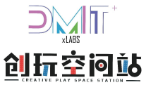
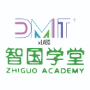

<!-- _class: notice  -->
<!-- _paginate: "" -->
<!-- _header: -->
<!-- _footer: -->

## 课程预告
### LMCC 第一课：AI就在身边

### 学习目标
1. **认识**：身边哪些功能其实是 AI
2. **体验**：让 AI 替你搜索、整理
3. **动手**：把表格做成 HTML 海报
4. **分辨**：识破 AI 一本正经地编

### 学习重点

- **编**：编个假书名，看 AI 怎么编简介
- **查**：让 AI 上网查，整理成表格
- **抓**：逐条核对，存疑的画圈
- **重做**：说清要求，不许它瞎猜

#### 授课教师： **冯世龙**
#### 上课时间： **2026-09-18（周五）16:30**

---
