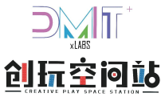
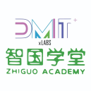

<!-- _class: notice  -->
<!-- _paginate: "" -->
<!-- _header: -->
<!-- _footer: -->

## 课程预告
### CAICP 知识点梳理（一）

### 学习目标
1. **过框架**：AI 知识、Python、计算思维
2. **抠高频**：AI 三要素、机器学习四范式
3. **练读码**：看代码说结果、挑毛病
4. **定清单**：记下自己的薄弱点

### 学习重点

- **三要素**：数据、算法、算力
- **四范式**：监督、非监督、半监督、强化
- **读码**：判输出、挑毛病
- **计算思维**：情景拆成步骤

#### 授课教师： **冯世龙**
#### 上课时间： **2026-11-03（周二）21:00 ～ 23:00**

---
